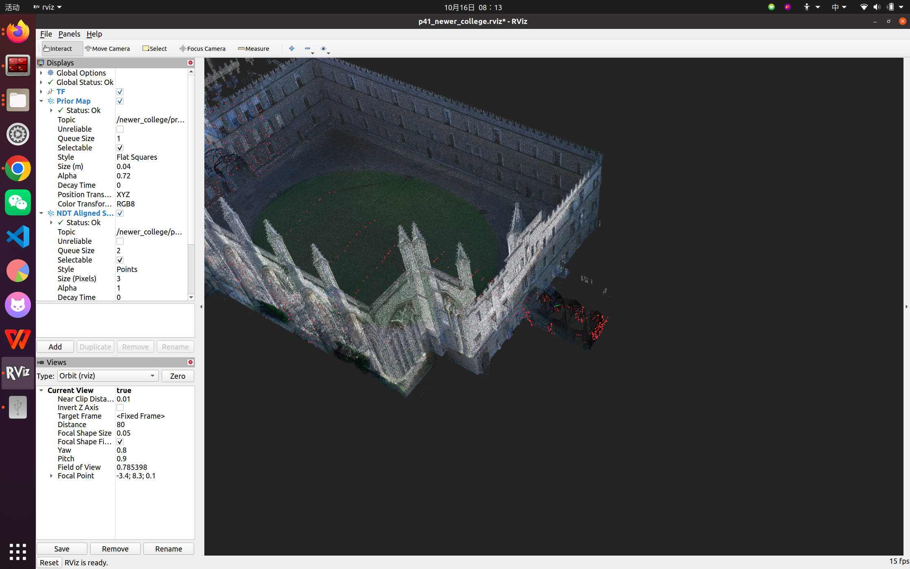

# RViz 验收

命令：

```bash
cd /home/jian/livox_ws/p10_corridor01_oosm_r1_ws
source /opt/ros/noetic/setup.bash
source /home/jian/livox_ws/devel/setup.bash
source devel/setup.bash
roslaunch dog_prior_map_localization newer_college_localization.launch
```

Launch 自动运行以下真实节点：

- `dog_prior_map_ndt`：现有 CONTROL NDT。
- `dog_prior_map_ekf`：现有 OOSM/EKF 管线。
- `newer_college_prior_map`：发布无坐标变换的官方 5 cm PLY→PCD 地图到 `/newer_college/prior_map`，latch=true。
- `newer_college_first_scan_input`：从外盘官方 PCD/IMU CSV 读取并发布一帧及真实时间 IMU 子集；等待 NDT 发布端就绪后才发布，避免地图加载竞态。
- `newer_college_rviz`：加载本包 `rviz/p41_newer_college.rviz`。

RViz 固定地图帧 `newer_college_map`，配置显示 `/newer_college/prior_map` 和 NDT 处理后的 `/newer_college/points_aligned`。本次条件性候选的实际验收截图：



单帧发布完成后可用 Ctrl-C 退出。输入器不是 rosbag 播放器；本轮没有声称跑完序列。

重要：上述截图来自条件性 base-axis Oracle 运行。默认 launch 使用官方 RS_C1 optical 帧链，本次该帧被几何门槛拒绝，故默认模式只应显示地图，不会发布 NDT 对齐点云。可用以下显式参数复现截图（仅诊断，不代表官方变换认证）：

```bash
roslaunch dog_prior_map_localization newer_college_localization.launch initialization_override:=$(rospack find dog_prior_map_localization)/config/p41_newer_college_conditional_base_axis.yaml
```
