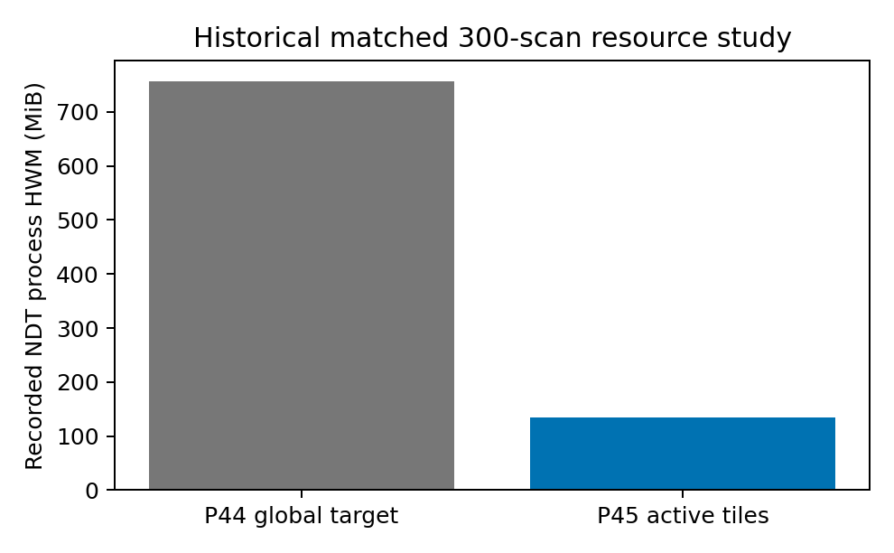
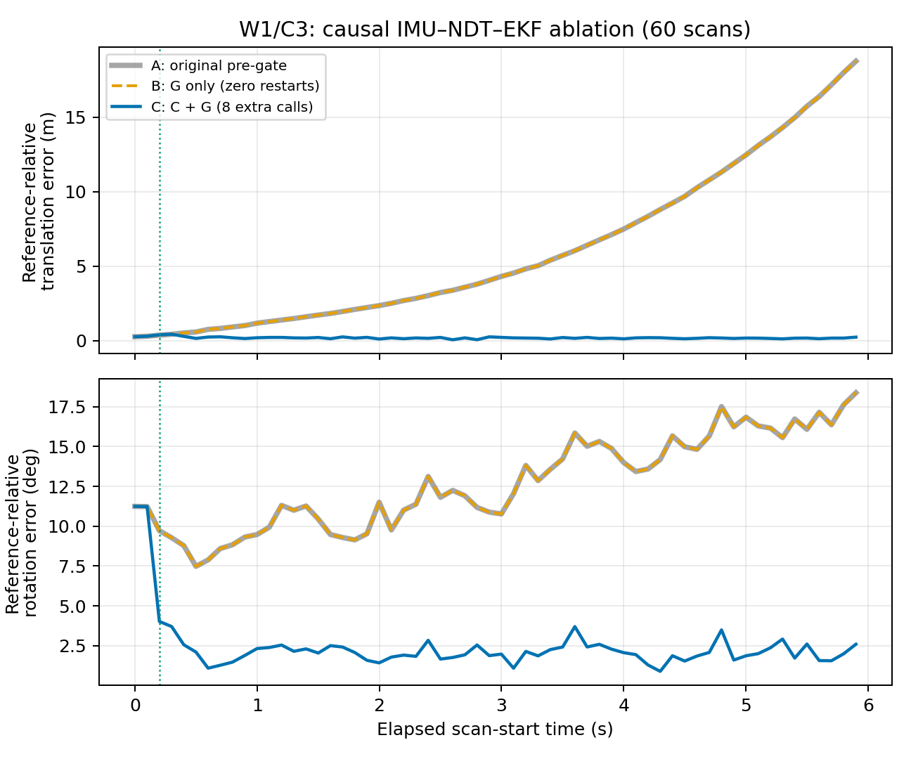
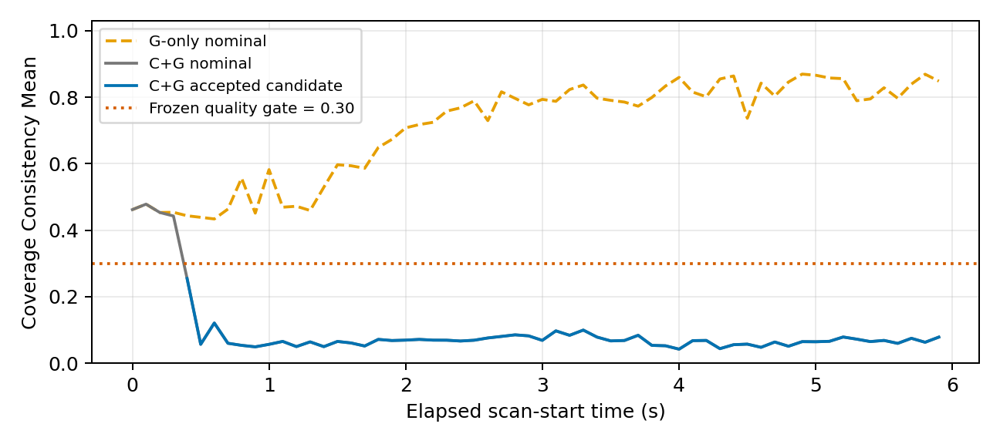

# Gate-Aware Budgeted NDT Recovery for Prior-Map LiDAR–Inertial Localization

*Complete revised manuscript for author and scientific review, R26. Author names and affiliations are to be supplied by the research team. Published reference results and our controlled causal results use separate protocols; this manuscript makes no external state-of-the-art ranking claim.*

## Abstract

Prior-map localization must balance registration reliability, inertial continuity, and computational cost. A practical difficulty is that a pre-optimization geometry check evaluates the current prediction rather than the pose that an optimizer could recover. Consequently, rejecting a poorly aligned scan before registration can prevent a useful map correction. We study a lightweight system combining native Normal Distributions Transform (NDT), local map targets, real inertial propagation, post-registration coverage consistency, and a bounded two-start recovery procedure. The optimizer, filter model, and quality thresholds remain fixed. A controlled causal ablation on Newer College shows that bypassing the pre-optimization veto alone is insufficient: all 60 nominal registrations converge, but none passes the frozen post-registration quality gate, and the inertial trajectory continues to drift. Allowing the same scans to reach a fixed yaw-restart procedure reduces complete-window translation and rotation RMSE from 7.986 m and 13.053 deg to 0.210 m and 2.984 deg, using eight additional registrations. An earlier matched-segment map study records an 82.2% reduction in NDT-process high-water memory, with latency and maximum-error tradeoffs. We also preserve a failed relative-admission generalization test and an unconsumed OOSM-history synchronization attempt. Published Newer College odometry and prior-map localization results are reported separately because their full-sequence, alignment and initialization protocols differ. The results support a narrowly defined engineering mechanism, not a new optimizer, universal recovery guarantee, or independent physical accuracy claim. Evaluation uses a conditionally interpreted, map-anchored benchmark reference; quadruped deployment remains blocked by an unverified LiDAR–IMU calibration chain.

**Keywords:** prior-map localization; normal distributions transform; inertial propagation; observation admission; bounded recovery; local maps.

## 1. Introduction

A robot operating in a previously mapped environment can avoid the cost of continuous map reconstruction by registering current LiDAR scans against a fixed prior. NDT is attractive for this setting because it represents target geometry statistically and estimates a rigid alignment from an initial pose. Its practical behavior nevertheless depends on initialization, map support, and the surrounding state-estimation architecture. Native convergence is an optimizer status, not a certificate that a pose is accurate. The original NDT formulation and its 3D development provide the registration foundation; our implementation retains the existing PCL solver rather than modifying its objective or derivatives. [1](https://www.diva-portal.org/smash/get/diva2:276162/FULLTEXT02.pdf), [2](https://pointclouds.org/documentation/tutorials/normal_distributions_transform.html)

A deployed prior-map system must make several different decisions. It must determine whether required map data are available, whether registration may be attempted, whether the resulting map observation is acceptable, and how the inertial estimator proceeds when an observation is rejected. These questions are related but not interchangeable. In particular, a nearest-map geometry statistic evaluated at a poor prediction may reject a scan that could support a useful alignment after optimization. Conversely, simply permitting registration does not guarantee that its output satisfies an unchanged observation-quality rule.

This paper investigates that distinction through a reproducible system study. The retained configuration combines an existing local-target manager, native Full NDT, causal IMU–EKF prediction, coverage-based post-registration admission, and a fixed event-triggered yaw-restart baseline. We call the removal of the *optimization veto* G and the bounded recovery procedure C. G preserves the original geometry thresholds as diagnostics and keeps all post-registration checks. It neither accepts an observation directly nor lowers a quality threshold.

Our principal contribution is empirical and implementation-oriented. First, we identify a concrete feedback failure in which a pre-optimization geometry veto prevents useful map corrections. Second, a new independently executed causal ablation on an exposed development window separates optimizer access from recovery: G-only produces 60 converged registrations but no accepted observation, whereas C+G admits a restart result and changes the subsequent fused trajectory. Third, we document resource behavior and failure boundaries, including a normal-initialization safety counterexample for relative-only admission. We do not claim that multistart search, threshold gating, map tiling, or degeneracy detection is new mathematics. The narrower claim is that their placement, budget, and interaction with a real filter must be evaluated causally rather than inferred from isolated registration scores.

## 2. Related Work

### 2.1. LiDAR–inertial odometry is a distinct evaluation task

FAST-LIO2 directly registers raw points within an iterated filtering architecture and maintains an incremental k-d tree [6]. DLIO combines continuous-time motion correction, a geometric observer, and direct scan-to-submap registration [11]. STEAM-LIO uses a Gaussian-process motion prior in continuous-time sliding-window estimation [12], while Singer-LIO examines treating inertial measurements as observations of the state [13]. These systems address estimation and mapping from an initially unknown environment. A map constructed incrementally from the estimated trajectory is different from an externally surveyed fixed prior.

These papers provide useful quantitative context on original Newer College Short. However, their trajectory-wide, usually aligned translation ATE is not the same experiment as our reference-initialized, deliberately perturbed short-window map localization. FAST-LIO2's 0.3775 m Short result in our published-results table was run by Chen et al. [11], rather than extracted from a Newer College table in the original FAST-LIO2 paper. Several later papers reuse it. Repeated citation of one measurement does not constitute independent replication.

Our integrated estimator reuses an existing custom IMU/EKF implementation, with real inertial propagation and delayed map observations. It is not identified as an unmodified FAST-LIO2 system. The FAST-LIVO2-derived map available for our robot assets likewise does not provide an independent physical reference for their own trajectory.

### 2.2. Fixed prior-map localization and the closest systems

2Fast-2Lamaa supports odometry, mapping and localization against global or topometric maps through continuous distance-field representations and continuous-time undistortion [10]. Its Newer College comparison explicitly separates Umeyama-aligned odometry ATE from direct map-frame localization RMSE. The latter is 0.128 m for the full 01_short sequence, making it a particularly relevant published localization reference. We acknowledge this result without comparing it as an equal-protocol score to our 60-scan perturbed-initialization experiment. Our implementation retains the PCL Gaussian NDT solver and existing EKF/OOSM; it neither introduces a continuous distance field nor claims a new global initializer. The difference studied here is whether a hard pre-alignment geometry veto prevents a fixed, budgeted retry from producing an admissible observation.

Koide et al. tightly couple scan-to-scan, scan-to-prior-map and IMU factors in a sliding-window optimizer, including gravity-aided initialization [14]. That work addresses robustness at map boundaries and under severe geometric ambiguity by changing the estimation formulation. We instead keep the solver and filter model unchanged and study the observation path between them. FAST-LIO-LOCALIZATION is a relevant practical software framework combining LIO with periodic prior-map corrections [15]; its README is not treated as a standalone peer-reviewed Newer College accuracy result. Neither system is equated with our controlled causal ablation, and no unrun baseline result is inferred.

### 2.3. Localizability and observation reliability

X-ICP characterizes direction-dependent registration strength and constrains updates, while GenZ-ICP adapts geometric residual weighting [3,4]. They modify the registration behavior rather than simply controlling whether a frozen optimizer is attempted. We do not present our input covariance prescreening as their localizability analysis or as the true NDT Hessian.

SuperLoc predicts alignment risk before optimization, estimates observability, and actively incorporates supporting pose priors [5]. It is the closest conceptual comparison for pre-registration reliability. G addresses a much narrower issue: an inherited nearest-map distance/overlap predicate can prohibit all optimization when the current prediction is misaligned. Turning that particular predicate into a diagnostic does not invalidate SuperLoc's risk assessment or imply that pre-optimization geometry should always be ignored. Post-registration quality rejection remains active. The papers use different data and evaluations, so we make no accuracy claim against SuperLoc.

### 2.4. Contribution boundary and resource accounting

Spatially restricting targets, reliability gating and multiple initializations are established ideas. Our contribution is a reproducible system-design interaction and its causal ablation: map availability, initial geometry diagnostics, optimized-observation admission and inertial continuity must be assigned distinct responsibilities. G-only and C+G are compared using the same raw input and parameters, while each evolves its own actual filter state. Memory scope is also explicit: NDT-process high-water memory, simultaneous sampled two-node RSS and another paper's final component RAM are different measurements. This positioning supports an engineering study; it does not establish a new registration objective or superior general localization performance.

## 3. Methodology

### 3.1. Frames, propagation, and measurement time

We use T_A_B to denote a transform mapping coordinates from frame B into frame A. The internal filter state refers to the IMU, while the registration observation is T_M_L, the LiDAR pose in the map. With the fixed sensor transform T_I_L,

$$T_{M,L}=T_{M,I}T_{I,L},\qquad T_{M,I}=T_{M,L}T_{I,L}^{-1}.$$

Newer College uses the previously frozen extrinsic chain and conditional Base interpretation. Each trajectory is initialized once from its anchor reference. The C3 condition rotates the anchor LiDAR attitude by +8 deg about map Z, keeps its position fixed, and recomputes the complete IMU pose including the lever arm. Initial velocity and biases are inherited zero priors, not measured zero motion or independently estimated biases.

Subsequent NDT initial poses come from actual causal IMU–EKF output. The node selects a delivered state at or before the scan reference and uses the existing bounded body-twist interface for at most 20 ms of projection. It does not read current or future reference poses. All compared methods run independent state histories. Equal raw inputs do not force equal deskewed points after histories diverge; that dependence is part of the closed loop.

The Newer College adapter defines the scan header as scan start and preserves point-relative times. Existing IMU-based Deskew also references scan start. NDT observations retain this measurement time even when computation finishes later. The original OOSM path applies a historical update within its 20 ms alignment tolerance and replays real IMU samples to the current state. Errors for the fused output are evaluated at that output's actual current-state time, approximately 100 ms after scan start, rather than against an earlier scan reference. No propagation, rollback, replay, or covariance model is redesigned.

### 3.2. Local target construction

The P45 manager starts from a frozen target obtained by two global 0.15 m voxel passes and partitions it into 20 m horizontal tiles. For each scan it projects the preprocessed source using the same causal prediction supplied to NDT, requests intersecting tiles with a 10 m safety margin, and uses an expanded 30 m selection at updates to provide hysteresis. If the active set covers the requirement, the merged target and target model are reused. The current registration result and evaluation reference do not select that frame's map. Missing or corrupted required map assets remain hard failures even when G is enabled.

The live NDT process does not load the entire visualization map. The optional RViz map publisher is separate and can dominate total display memory. Actual target point counts, tile IDs, and fingerprints are logged because different causal trajectories could select different maps. In the principal W1/C3 ablation, all three conditions retain the same 2,297,615-point target fingerprint, eliminating a target-content explanation for the observed difference.

### 3.3. Pre-optimization geometry diagnostics

At prediction T_P, the existing geometry check computes nearest-map distances for the preprocessed source. Its original predicate is

$$\operatorname{median}(d)\le1.0\,\mathrm m,\quad P_{90}(d)\le3.0\,\mathrm m,\quad O_{0.5}(T_P)\ge0.50.$$

The original configuration returns before NDT if any condition fails. G records exactly the same metrics and decision but permits native registration to proceed. G does not declare the prediction accurate or force acceptance of an optimized pose. It changes which component is responsible for judging an observation: initial geometry becomes diagnostic, while post-registration quality remains authoritative. No geometry threshold is relaxed.

### 3.4. Native NDT and coverage consistency

Full Source preprocessing remains 0.25 m voxelization, 0.5–80 m range filtering, and a deterministic maximum of 1,400 points. The unchanged PCL NDT uses resolution 0.8 m, step 0.08, transformation epsilon 0.001, 40 maximum iterations, and outlier ratio 0.55. Every selected seed receives one native alignment; no post hoc candidate is presented as a converged native result.

The frozen Coverage V2 code divides scanner-frame azimuth into 16 sectors. Eight odd sectors define potential quality blocks. A block is active if its input count is at least 10; at least four active blocks and 300 even-sector points are required. Activity is fixed before optimizing candidates. For active block b,

$$L_b(T)=\frac{1}{|S_b|}\sum_{p\in S_b}\min\left(\frac{d(Tp,\mathcal M)^2}{(0.5\,\mathrm m)^2},1\right),\qquad Q(T)=\frac{1}{B}\sum_{b\in\mathcal A}L_b(T).$$

Overlap is the fraction of active-block points within 0.5 m of the target. Missing blocks are unavailable, not zero-loss observations. A candidate must be a valid finite native result, converge, have evaluable coverage, and satisfy overlap at least 0.50. The retained absolute quality gate additionally requires Q at most 0.30.

These blocks participate in Full NDT optimization. Q is therefore **Coverage Consistency Mean**, not independent holdout evidence. It is a deterministic spatial quality diagnostic, not a calibrated probability of correctness. The 0.30 threshold was developed on the earlier R19 observations and is not presented as universal.

### 3.5. Event-triggered bounded recovery

C first evaluates one nominal Full NDT result from T_P. If it passes quality, it is admitted without extra search. Otherwise, with remaining budget, C constructs two seeds:

$$R_{\pm}=R_z(\pm5^\circ)R_P,\qquad p_{\pm}=p_P.$$

Only attitude is changed; left-multiplying the entire transform and rotating its translation would implement a different operation. Each seed is optimized once using the same Full Source and target. Every resulting candidate must pass the same basic and absolute quality gates.

Among accepted candidates C selects the highest native transformation-probability score. An exact tie is resolved by smaller dimensionless prediction distance, then smaller fixed candidate ID. The distance uses translation normalized by 0.8 m and rotation by 5 deg. In the actual retained r20::accepted implementation these are tie-break scales, not hard candidate-to-prediction admission bounds. A separate inherited publication limiter bounds successive NDT observation steps by 0.5 m/5 deg, and the existing filter has its own update limits. Raw, selected, and published poses are logged separately.

Each event permits at most two extra calls; each approved 60-scan run permits 12 extras. This is a hard experimental per-run quota, not an evaluated indefinite sliding-budget scheduler. If no candidate passes, no map measurement is published and the existing IMU estimator continues. Prediction is never relabeled as an independent NDT observation. Relative-only admission, temporal confirmation, coupled refinement, and the robust paired selector are excluded from the retained method.

**Algorithm 1 — frozen C+G measurement path**

```text
used_extra = 0                         # quota belongs to this approved run
IMU propagation runs through the existing filter independently
for each scan in chronological order:
    TP = existing causal IMU/EKF prediction at scan reference
    target = existing map manager selection from source and TP
    if required map assets are invalid: publish no map measurement; continue
    record original pre-geometry decision                 # G does not veto
    candidates = [native Full NDT(source, target, TP)]
    if nominal fails unchanged quality and used_extra + 2 <= 12:
        add one Full alignment from each fixed map-yaw +/-5deg seed
        used_extra += 2
    select only candidates passing the unchanged absolute quality gate
    if none pass: publish no map measurement
    else: use the existing observation-limiter/publication/OOSM path
```

G-only executes the same path but never enters the extra-alignment branch.

### 3.6. G-only ablation

The new G-only condition enables optimization despite the same pre-gate failure but disables all extra search. It retains the identical post-quality predicate and selects only an eligible nominal result. It runs a new independent 60-frame causal state sequence. This separates “NDT was allowed to run” from “an additional initialization supplied an admissible map observation.” Historical original and C+G trajectories are cited without rerunning or reordering their per-frame outputs.

## 4. Experimental Setup

### 4.1. Data and reference limitations

Newer College `01_short_experiment` provides actual Ouster scans, inertial measurements, an independently acquired Leica prior map, and an official reference trajectory. The reference trajectory itself is generated by scan-to-map registration; it is not independent motion-capture truth. [7](https://arxiv.org/abs/2003.05691), [8](https://ori-drs.github.io/newer-college-dataset/ground-truth/)

The archived Base interpretation is supported by the dataset paper and pinned robot-model evidence, but a direct binding to the local CSV export convention remains unresolved. The official documentation also distinguishes stereo and multicamera reference frames. We retain the single previously approved interpretation, do not select axes by matching error, and report **reference-relative pose error** throughout. The map is independently surveyed; the trajectory reference is map anchored. These two independence claims must not be conflated. [8](https://ori-drs.github.io/newer-college-dataset/ground-truth/), [9](https://github.com/ori-drs/frontier_description/blob/0b039393334a7767e24a711bd05816bfc7f7485a/README.md)

Table 1 separates protocols that must not be pooled as one experiment.

|Cohort|Input and estimator|Scope|
|---|---|---|
|P45 resource study|Matched 300-scan segment; IMU/EKF and local target|Historical spatial-memory comparison; no live tile crossing|
|R19 basin test|Two windows, four initializations, 60 scans each; optimizer-only causal predictor|480 native outputs plus 6 stability checks|
|R20–R21 development|Same two windows, C0/C3; causal quality/recovery policies|Development evidence, not new holdout|
|R22 holdout|Four specified new windows; four policies and C0/C3|32 independent 60-frame causal trajectories; no IMU/EKF|
|R23–R24 closure|W1 anchor 2600 and W3 anchor 6500,60 tests each; true IMU/EKF|Known development windows with independent runs|
|R25 G-only|W1/C3, raw 2601–2660; true IMU/EKF|One new 60-frame ablation, zero extra calls|

The official original Stereo-Cam index describes the Short experiment as 1530 s with Ouster OS1 LiDAR and its internal IMU [16]. Published names `Short`, `01-Short` and `01_short` correspond to this original sequence: their reported length is about1609 m, and the public STEAM-LIO and Singer-LIO `01_short_experiment` outputs each contain15301 timestamps exactly matching the local raw PCD order. This establishes sequence identity, not identical evaluation conditions. Later Multi-Cam/OS0 sequences are not substituted.

R19/R20 use frozen 50 m static ROIs and a historical causal pose predictor, whereas the integrated experiments use real IMU/EKF, actual Deskew, and P45 target selection. Accuracy changes across these cohorts cannot be attributed to one algorithmic component.

### 4.2. Evaluation and reproducibility

All native outputs and online decisions are sealed before test reference values are read. There is no per-method trajectory alignment. Translation error is the Euclidean position difference; rotation error is the angle of R_ref^T R_est. We report RMSE, P95, maximum, and counts above 0.5 m or5 deg. Rejected scans retain their actual propagated output and are not assigned zero error. Reference matching uses the frozen bounded interpolation rule, not error-minimizing time shifts.

Runtime records distinguish native calls, node callbacks, input-to-fusion acknowledgment, first target construction, and process wall time. RSS for recent integrated runs is sampled every 50 ms; it is neither an exact instantaneous memory bound nor total machine consumption. Release builds and native parameters are frozen. The G-only NDT binary is rebuilt; the unchanged EKF and publisher binaries are reused with exact R24 hashes. Its native seal precedes evaluation in commit `0d4a56f55b6550a61d5c97fa6945d853cc8e49a5`.

The integrated W1 comparison has60 evaluation scans, raw2601–2660, after reference initialization at raw2600. C3 applies map-axis yaw+8deg to that initial state consistently across the estimator and registration; subsequent states are causal, not initialized from current reference poses. Raw measurements, initialization, calibration, map-selection parameters, Deskew model and NDT configuration are identical. Deskewed point coordinates may subsequently differ as an intended consequence of different filter histories. The actual target set remains unchanged in the decisive ablation.

For reproducibility of reference-relative metrics, each state is compared at its own recorded time: NDT at scan reference and EKF at its actual propagated watermark, which can be later than scan start. The frozen reference interpolation limits are150ms for a bracketing gap and50ms for a near endpoint; no time shift is fitted. Only anchor reference poses enter initialization. Test reference values are read after native outputs and admission decisions have been sealed. Selected historical receipts do not identify a complete CPU model for all internal resource runs; we report this as NR rather than retrospectively assigning today's workstation specification.

The windows and initialization conditions are fixed. There are no repeated independent trials from which to infer confidence intervals or broad statistical significance; neighboring frames are temporally dependent. C3 evaluates recovery from a known perturbed initialization, not unknown-pose global relocalization.

## 5. Results

### 5.1. Local target resource behavior

The historical P45 matched 300-scan study reduces the active target from 3,142,751 points to 552,716 points. Recorded NDT-process high-water memory decreases from 775,308 KiB to 138,200 KiB, an 82.2% reduction. Translation RMSE changes from 0.067985 m to 0.061612 m. However, translation maximum increases from 0.119675 m to 0.216396 m, and rotation RMSE rises from 1.81802 deg to 1.87495 deg. Steady alignment mean increases from 7.086 ms to 8.079 ms. Input-to-final-acknowledgment wall time 33.82 s exceeds the 29.90 s sensor span.



**Figure 1.** Recorded per-process HWM in the historical matched-segment study. Different recording arrangements and profiles preclude an identical-binary microbenchmark interpretation. The live path did not cross a tile boundary; a separate replacement probe used a synthetic pose and zero NDT calls. No universal whole-system memory or real-time claim follows.

### 5.2. Initialization sensitivity and simple quality baselines

R19 observes persistent distinct native terminal neighborhoods in the strong-input-geometry C3 trajectory. Its translation/rotation RMSE is0.947759 m/7.788894 deg, versus 0.159179 m/2.033813 deg for C0. Six repeated optimizations near the earliest qualifying three-frame segment remain within 0.031275 m/0.197372 deg of their respective terminals. This supports stable distinct convergence behavior, not a proof of strict mathematical local minima.

The harmful branch has substantially lower native scores and degraded coverage. A threshold developed from these observations, Q>0.30, flags all 21 reference-relative suspect records among 480 original outputs, together with 14 other records. The latter records are additional alarms, not independently certified false positives. The apparent detection coverage is a development statistic.

R20 separates detection from causal recovery:

|Window/C3|Native baseline RMSE m/deg|Quality gate only|Quality-triggered multistart|
|---|---|---|---|
|WEAK|0.283121 /2.808664|4.164507 /7.016976|0.266655 /1.862490|
|STRONG|0.947759 /7.788894|0.351154 /4.143002|0.351154 /4.143002|

Gate-only rejects enough observations to damage the weak-window predictor; multistart restores useful measurements there. In the strong window multistart adds no trajectory benefit and misses the preset 0.35 m/3 deg dual target. Some physically different candidates improve reference error but remain above the fixed quality threshold. This prevents a claim that the absolute gate always admits beneficial corrections.

### 5.3. A rejected extension: relative-only admission

R21's single-frame Pareto admission produces a favorable strong-window development result: 0.158692 m/2.071567 deg versus R20 C's 0.351154 m/4.143002 deg. Two-frame confirmation is not better and adds a real confirmation call and delay. The subsequent frozen R22 test exposes an important counterexample. On W1/C0, C achieves 0.211401 m/2.422765 deg, while relative admission produces 0.242043 m/2.620034 deg and increases high-error frames from 2 to 5. The translation degradation 0.030641 m exceeds the prespecified safety boundary. A favorable W1/C3 result does not erase this normal-initialization failure; three other windows do not exercise the relative-only mechanism. We therefore exclude that extension rather than adding another fitted threshold.

### 5.4. True inertial closure and geometry responsibility

R23 verifies actual inertial propagation, native registration, and delayed map-observation fusion. Across ten formal trajectories it records 432 Full NDT calls, 6,110 original IMU propagations, and 418 applied map updates. Yet W1/C3 never enters NDT: the existing pre-gate rejects all 60 scans and the inertial state drifts. The result cannot be interpreted as an optimizer failure because no alignment was attempted.

R24 G changes only this optimization veto while retaining C and all post-quality criteria. In W1/C3, the new causal path violates the original geometry predicate on its first four scans. A restart result becomes admissible at raw 2603, after which the state history changes and the original geometry predicate eventually passes. The configuration publishes 57 map observations and uses eight extra registrations. G+F produces the same poses as G. The F-enabled and G+F runs receive 415 corrected messages and replace four exact same-time samples, but no subsequent NDT query consumes a replaced sample. The four replacements are later than the next scan start and are correctly excluded. This is not a demonstrated prediction-freshness fix.

### 5.5. Controlled G-only ablation

The sealed R25 run executes 60 nominal Full registrations, all converged, with zero additional calls. None passes the retained post-quality gate. Its entire EKF and prediction pose sequences equal the original rejected-observation trajectory.

**Table B. Controlled causal ablation, complete W1/C3 window.**

|W1/C3 method|Translation RMSE/P95/Max m|Rotation RMSE/P95/Max deg|Native nominal+extra|Accepted/rejected|High-error frames|
|---|---|---|---:|---:|---:|
|Original pre-gate, R23|7.986422 /16.421686 /18.755587|13.052649 /17.166246 /18.375466|0+0|0/60|60|
|G-only, R25|7.986422 /16.421686 /18.755587|13.052649 /17.166246 /18.375466|60+0|0/60|60|
|C+G, R24|0.209943 /0.300124 /0.444282|2.984149 /3.723287 /11.245245|60+8|57/3|2|

The optimizer-access change alone is insufficient in this case. The additional candidate from the fixed -5 deg seed at raw 2603 has Q=0.296356, passes the unchanged gate, and actually reaches the filter. Raw 2604 is rejected again, while raw 2605 onward admits nominal measurements. The longest no-map interval decreases from 60 scans to 2. Raw 2603 is both the first map update and the first output below the existing 0.5 m/5 deg reference-error criterion for the remainder of the approved window. That recovery-time description is post hoc and did not select a candidate.



**Figure 2.** Complete 60-frame W1/C3 errors. Original and G-only curves coincide; the green line marks the first C+G map update. Horizontal position uses scan-start elapsed time, while each error is evaluated at its actual fused-state timestamp. The two initial large rotation errors remain visible.



**Figure 3.** Frozen Coverage Consistency Mean and the 0.30 quality gate. Missing selected values are gaps, not zero losses. The plot concerns quality admission rather than independent correctness.

C+G reduces complete-window translation RMSE by 97.4% and rotation RMSE by 77.1% relative to the original/G-only output in this development instance. It does not remove the initial transient: maximum rotation error is11.245245 deg and two scans exceed 5 deg. On the normal W1/C0 and W3/C0 controls, R24 G and G+F preserve the original error sequences. These controls do not establish safety outside the tested windows.

### 5.6. Cost and robot-validation status

|W1/C3 method|Callback Mean/P95/Max ms|NDT sampled peak KiB|Simultaneous NDT+EKF peak KiB|
|---|---|---:|---:|
|Original pre-gate|30.352 /39.254 /602.224|259060|282196|
|G-only|110.496 /179.406 /977.302|369136|389380|
|C+G|55.304 /111.302 /1006.031|369096|392536|

The original path completes less work because it never calls NDT. C+G uses 13.3% more solver calls than G-only but follows a different subsequent optimization branch. Its lower observed callback mean is not a repeated-trial speed guarantee. Initialization and map construction affect maxima; neither this table nor a low mean proves 10 Hz operation. The larger active target in this window also explains why the earlier 135 MiB P45 process figure is not a universal memory budget.

The local quadruped loop2 assets are present: a 19.68 GB bag with 10,905 Mid-360 scans, 218,101 IMU messages, and a matching FAST-LIVO2 prior. However, its actual mapping configuration uses identity/zero LiDAR–IMU extrinsics explicitly as a fallback assumption. No physically established transform chain was available. We therefore do not execute or invent a new DOG_BASELINE versus DOG_CG result. Existing FAST-LIVO2 mapping poses are a same-system reference, not independent truth. A visualization-only configuration is supplied but has not been accepted as a robot localization launch.

### 5.7. Published Newer College results under their original protocols

**Table A. Published reference results, not a matched ranking against our method.** These translation-only results concern the original complete Short experiment, nominally1530s/1609m. NR means not reported at that scope. The current 2Fast author manuscript has Table7; source versions and pages are pinned in the supplementary extraction ledger.

|Method and original result source|Task|Position result m|Trajectory treatment|Cost at original reported scope|
|---|---|---:|---|---|
|FAST-LIO2, Chen2023 TableI [11]|Odometry ATE RMSE|0.3775|evo; exact original alignment flags NR; later compiled comparisons specify Umeyama|42.86ms, average of five NC sequences|
|DLIO continuous, Chen2023 TableI [11]|Odometry ATE RMSE|0.3606|evo; exact original alignment flags NR|35.74ms, same five-sequence scope|
|STEAM-LIO, Burnett2025 TableII [12]|Odometry ATE RMSE|0.3042|Umeyama SE(3) alignment|74ms NC average|
|Singer-LIO, Burnett2025 TableIII [13]|Odometry ATE RMSE|0.3020|Umeyama alignment|NR for this experiment|
|2Fast-2Lamaa, Le Gentil2026 Table7 [10]|Global-map odometry ATE RMSE|0.262|Umeyama alignment|Separate resource ablation; NC-specific timing NR|
|2Fast-2Lamaa, same Table7 [10]|Fixed prior-map localization RMSE|0.128|Direct map-frame position comparison|Separate resource ablation; NC-specific timing NR|

The first three figures are also printed as0.378,0.360 and0.304 in 2Fast Table7. That paper explicitly obtains FAST-LIO2/DLIO results from Chen et al. and STEAM-LIO results from Burnett et al.; they are not new 2Fast-author baseline executions. The original DLIO0.3606 and later printed0.360 are retained at their respective precision without inventing an explanation for the digit difference. Chen et al. exclude the first100 FAST-LIO2 poses on some sequences; the exact affected list is NR. Thus even published “full-sequence” labels do not guarantee identical timestamp subsets. No corresponding Short rotation RMSE is reported in these tables.

The full-sequence0.128m fixed-map localization result is especially relevant, but it is not a controlled match for our disturbed6s window: initialization, representation, body-frame convention, fusion timing and duration differ. Conversely, aligned odometry ATE removes a global trajectory transform that our map-localization metric does not fit. We therefore neither insert0.209943m into TableA nor claim that the published values rank the present method. SuperLoc and Koide et al. provide valuable prior-map comparisons on different data, and are discussed technically rather than assigned fabricated Newer College scores.

**Public-output reuse.** The official STEAM repository supplies Short trajectories labeled STEAM-LIO and Singer-LIO. Exact identity to the published table-run configuration is not certified. We checked their15301 finite TUM rows and exact timestamp agreement with our scan files, without using reference errors. They start at approximately zero position and identity orientation, and the result files do not themselves certify a Leica-map transform or the sensor-frame binding to our conditional Base interpretation. They also do not embody our+8deg window reset. No new window error is produced by fitting a transform. Our longest matched in-house resource segment has300 scans, so we also cannot manufacture a full1530s C+G score by concatenating independent windows. All public results are reused without compiling external software or rerunning native baselines.

### 5.8. Resource context from published implementations

**Table C. Selected public resource reports; hardware, component and dataset scopes differ.** Internal process/paired RSS and the P45 spatial-memory comparison are given separately in Sections5.1 and5.6.

|Published system|Timing / compute|Memory|Platform and measurement scope|
|---|---|---|---|
|FAST-LIO2 as run by Chen [11]|42.86ms per scan|NR|i7-11800H, described as16-core; five NC sequences average|
|DLIO continuous [11]|35.74ms per scan|NR|Same Chen platform/scope|
|STEAM-LIO [12]|74ms per scan|NR|XeonE5-2698v4,16threads; NC average|
|Singer-LIO [13]|NR at NC scope|NR|NC hardware profile NR|
|2Fast baseline localization [10]|8.86% total CPU; mean component core use1.06/0.71|Final component RAM0.17/0.32GB|i7-1370p,32GB installed; Boreas-RT ablation, not NC|
|2Fast global-map localization [10]|9.16% total CPU; mean component core use1.05/0.78|Final component RAM0.16/2.24GB|Same platform; Table12 resource profile, not the NC Table7 run|
|SuperLoc [5]|45ms per frame,22FPS|NR|Ryzen73700X8-Core; different datasets and pipeline|

For a typical Suburbs sequence, 2Fast reports41ms undistortion/odometry,61ms keyframe registration and54ms map update, or19ms without carving [10]. These are different modules and cadences; summing or comparing them as a common per-LiDAR-frame stopwatch would be misleading. Similarly, its final RAM per component is not the same statistic as our NDT HWM or simultaneously sampled two-node RSS. Different hardware, point budgets, map sizes and fusion paths preclude a defensible inter-paper speedup or memory ratio. The only82.2% reduction claimed here belongs to the historical matched P45 global/local-target comparison, with its disclosed tradeoffs.

## 6. Discussion

### 6.1. What has been established

The principal evidence is a causal interaction. A hard pre-optimization veto prevents the optimizer and its recovery baseline from being exercised. Enabling optimization is necessary but, under a strict unchanged post-quality gate, not sufficient. A fixed additional initialization supplies the first admitted observation and changes the later inertial trajectory. This is stronger than reordering frozen candidates because both G-only and C+G histories are actual independent closed-loop executions. It remains one known development instance, not a general theorem about registration basins.

The result also distinguishes convergence, admission, and accuracy. All G-only nominal registrations converge, but no observation is admitted. An admitted C+G observation changes the trajectory, but the accuracy claim comes only from later reference-relative evaluation. The official reference and frame assumptions limit that claim; coverage and native scores do not replace physical truth.

### 6.2. Scope of originality and external comparison

We do not claim a new NDT objective, degeneracy detector, Schur-complement solver or invention of multistart search. 2Fast-2Lamaa already demonstrates efficient prior-map localization with a new continuous distance-field representation; SuperLoc already assesses alignment risk and adapts supporting fusion; Koide et al. already tightly couple prior-map and inertial constraints [5,10,14]. Our smallest concrete distinction is an attempt/admission responsibility change around a frozen native NDT/filter pipeline, evaluated by an independent causal G-only ablation. This is narrower than a novel general localization framework.

The evidence supports retaining C+G as a useful engineering baseline and a system-design contribution candidate. It does not establish methodological novelty sufficient for a particular journal. No directly comparable external disturbed-initialization result was established, and TableA cannot fill that gap. Any claim to outperform contemporary prior-map localization would require an explicitly matched protocol, not a percentage calculated between a short conditional map-relative RMSE and full-sequence aligned odometry ATE. The present manuscript intentionally makes the more limited claim and leaves venue suitability to scientific and editorial review.

### 6.3. Remaining failures and limitations

The raw scan covariance ratio used for prescreening is not the native NDT Hessian or a proof of intrinsic degeneracy; the sustained failure occurred in the nominally stronger input-geometry window. The fixed absolute quality gate can reject a reference-improving result, as seen in the strong development window. The successful W1/C3 candidate is close to the threshold; no robustness sweep is performed or used to retune it. Relative-only admission has a concrete safety counterexample and is excluded. Initial rotation transients remain even when window RMSE improves. Per-run recovery budgets do not demonstrate indefinite operation.

Freshness is also unresolved. Publishing a corrected current state does not update a previously delivered earlier prediction sample. Exact timestamp matching frequently fails because of the inherited integer-header versus double-time publication path, and a legal latest-sample replacement can still lie after the next scan start. The tested F switch does not justify a claim that this history is synchronized. We retain the existing filter behavior and disclose the limitation rather than changing its mathematics during the ablation.

Finally, the experiments share one public sequence and several intentionally perturbed, reference-anchored short windows. They establish neither independent motion-capture precision nor cross-dataset generalization. The surveyed prior and map-registered reference share geometry. The conditional Base interpretation lacks direct CSV-export certification. Robot assets are real but a valid deployment comparison is blocked by physical calibration provenance. These limitations preclude a claim that the quadruped system is deployment-ready or that a universal 0.30 threshold has been validated.

## 7. Conclusion

We presented and causally evaluated a resource-conscious prior-map NDT system with geometry-aware optimizer access, fixed post-registration quality admission, real inertial continuity, and bounded yaw restarts. A new G-only ablation shows that merely permitting registration does not recover a rejected-observation trajectory:60 converged nominal results still yield no map updates. The frozen C+G combination admits a restart result, reduces complete-window RMSE to 0.210 m/2.984 deg, and retains most subsequent map observations using eight extra calls. Historical local-target measurements support a spatial memory benefit with explicit timing and tail-error tradeoffs. These results justify retaining the simple combination as an engineering baseline and manuscript contribution candidate. They do not establish new optimization theory, independent physical accuracy, universal reliability, or completed robot deployment.

## References

1. M. Magnusson. *The Three-Dimensional Normal-Distributions Transform—An Efficient Representation for Registration, Surface Analysis, and Loop Detection*. Doctoral thesis, Örebro University, 2009. [Institutional repository](https://www.diva-portal.org/smash/get/diva2:276162/FULLTEXT02.pdf).
2. Point Cloud Library. *How to use Normal Distributions Transform*. [Official documentation](https://pointclouds.org/documentation/tutorials/normal_distributions_transform.html). Runtime version in this work:PCL 1.10; accessed 2026-10-24.
3. T. Tuna, J. Nubert, Y. Nava, S. Khattak, and M. Hutter. *X-ICP: Localizability-Aware LiDAR Registration for Robust Localization in Extreme Environments*. arXiv:2211.16335,2022; revised 2024. [Primary manuscript](https://arxiv.org/abs/2211.16335).
4. D. Lee, H. Lim, and S. Han. *GenZ-ICP: Generalizable and Degeneracy-Robust LiDAR Odometry Using an Adaptive Weighting*. arXiv:2411.06766,2024; IEEE RA-L, DOI 10.1109/LRA.2024.3498779. [Primary manuscript](https://arxiv.org/abs/2411.06766).
5. S. Zhao, H. Zhu, Y. Gao, B. Kim, Y. Qiu, A. M. Johnson, and S. Scherer. *SuperLoc: The Key to Robust LiDAR-Inertial Localization Lies in Predicting Alignment Risks*. ICRA2025, pp14080–14086. DOI10.1109/ICRA55743.2025.11127720; arXiv:2412.02901. [Primary manuscript](https://arxiv.org/abs/2412.02901).
6. W. Xu, Y. Cai, D. He, J. Lin, and F. Zhang. *FAST-LIO2: Fast Direct LiDAR-Inertial Odometry*. IEEE T-RO38(4), pp2053–2073,2022. DOI10.1109/TRO.2022.3141876; arXiv:2107.06829. [Primary manuscript](https://arxiv.org/abs/2107.06829).
7. M. Ramezani, Y. Wang, M. Camurri, D. Wisth, M. Mattamala, and M. Fallon. *The Newer College Dataset: Handheld LiDAR, Inertial and Vision with Ground Truth*. IROS 2020, pp. 4353–4360. DOI 10.1109/IROS45743.2020.9340849. [Primary manuscript](https://arxiv.org/abs/2003.05691).
8. Oxford Robotics Institute. *Newer College Dataset—Ground Truth*. [Official reference-construction documentation](https://ori-drs.github.io/newer-college-dataset/ground-truth/). Accessed 2026-10-24.
9. Oxford Robotics Institute. *frontier_description*, newer-college-dataset branch, pinned commit 0b039393334a7767e24a711bd05816bfc7f7485a. [Official frame-model evidence](https://github.com/ori-drs/frontier_description/blob/0b039393334a7767e24a711bd05816bfc7f7485a/README.md).

10. C. Le Gentil, R. Falque, D. Lisus, and T. D. Barfoot. *2Fast-2Lamaa: Large-scale lidar-inertial localization and mapping with continuous distance fields*. IJRR,2026, OnlineFirst. DOI10.1177/02783649261451003. [Publisher](https://doi.org/10.1177/02783649261451003); [public author manuscript v3](https://arxiv.org/pdf/2410.05433v3). Numeric inspection: Table7 p18; resource Table12/§9.7 p21. Full publisher PDF was not retrieved; author version is identified explicitly.
11. K. Chen, R. Nemiroff, and B. T. Lopez. *Direct LiDAR-Inertial Odometry: Lightweight LIO with Continuous-Time Motion Correction*. ICRA2023, pp3983–3989. DOI10.1109/ICRA48891.2023.10160508. [Paper](https://arxiv.org/abs/2203.03749); [official code](https://github.com/vectr-ucla/direct_lidar_inertial_odometry). Inspected PDF TableI p5; §IV-B1 p6.
12. K. Burnett, A. P. Schoellig, and T. D. Barfoot. *Continuous-Time Radar-Inertial and Lidar-Inertial Odometry Using a Gaussian Process Motion Prior*. IEEE T-RO41, pp1059–1076,2025; online25December2024. DOI10.1109/TRO.2024.3521856. [Author PDF](https://www.dynsyslab.org/wp-content/papercite-data/pdf/burnett-tro24.pdf). Inspected author version TableII p10,§VI-B p11.
13. K. Burnett, A. P. Schoellig, and T. D. Barfoot. *IMU as an input versus a measurement of the state in inertial-aided state estimation*. Robotica43, pp680–700,2025. DOI10.1017/S0263574724002121. [Publisher](https://doi.org/10.1017/S0263574724002121). TableIII printedp698, PDFp19. STEAM/Singer [official code and outputs](https://github.com/utiasASRL/steam_icp).
14. K. Koide, S. Oishi, M. Yokozuka, and A. Banno. *Tightly Coupled Range Inertial Localization on a 3D Prior Map Based on Sliding Window Factor Graph Optimization*. ICRA2024, pp1745–1751. DOI10.1109/ICRA57147.2024.10611195. [Author PDF](https://staff.aist.go.jp/k.koide/assets/pdf/icra2024_02.pdf); [official project](https://staff.aist.go.jp/k.koide/projects/icra2024_gl/). TableI/indoor setup PDFp5.
15. HViktorTsoi. *FAST-LIO-LOCALIZATION*. [Official software repository](https://github.com/HViktorTsoi/FAST_LIO_LOCALIZATION), accessed2026-10-24. Software, not a separately verified peer-reviewed paper.
16. Oxford Robotics Institute. *Newer College Dataset—Stereo-Cam*. [Official sequence and sensor index](https://ori-drs.github.io/newer-college-dataset/stereo-cam/), accessed2026-10-24.

## Reproducibility appendix

Internal evidence is archived by experiment, not pooled into one claim: `docs/p45_newer_college_local_map/`; `docs/p62_r19_native_ndt_basin_stress_test/`; `docs/p62_r20_quality_gated_recovery/`; `docs/p62_r21_relative_temporal_admission/`; `docs/p62_r22_frozen_relative_holdout/`; `docs/p62_r23_real_imu_closure/`; `docs/p62_r24_geometry_oosm_freshness/`; and `docs/p62_r25_results_to_paper_closure/`. R25 provides native/source identities, raw run logs, complete ablation tables, figure data and PNG/PDF/SVG exports. Historical outputs are not overwritten. The dog asset contract separately marks blocked versus measured fields. R26 adds a primary-source extraction ledger, source hashes/version locators, public-trajectory availability/time checks, comparability grades and this complete revised paper in `docs/p62_r26_published_comparison/`. Seven published papers and one software project are distinguished. It performs zero new NDT calls, external reproductions or dataset downloads. No new experiment is implied by the manuscript's revision.
