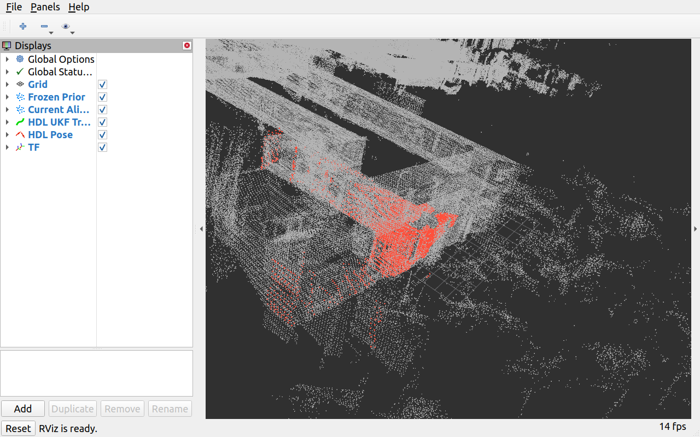

# 可视化入口与实际证据

正式试验启动了RViz，但原截图是Noetic模态提示，不是地图画面，保存在raw/RVIZ.png.gz；不能据此宣称live可视化已验收。运行后只在RViz进程加入DISABLE_ROS1_EOL_WARNINGS=1；没有更改NDT、UKF、地图、frame或初值。桥另加输出目录自动创建，不改变点数据。

随后运行一次**封存输出预览**：只启动原地图server和RViz，没有HDL localizer；显示400个已封存滤波位姿、最后一帧原始扫描经其封存raw NDT终值变换的点、固定先验地图及末态TF。新增align=0、UKF更新=0。屏幕实际检查见FROZEN_OUTPUT_PREVIEW.png和PREVIEW_RECEIPT.json。这张图片是封存结果显示，不是第二次定位实验，也不是绝对精度证明。



## 一键live启动入口

在具有本机图形会话的终端执行，输出目录必须是新的。以下参数及匹配主干来自已执行试验；仅GUI提示关闭和自动建目录为post-run交付修改，没有再次执行live400帧：

```bash
bash --noprofile --norc -c 'source /opt/ros/noetic/setup.bash && source /home/jian/livox_ws/p63_r3_hdl_data/catkin_ws/devel/setup.bash && export LD_LIBRARY_PATH=/usr/lib/x86_64-linux-gnu:${LD_LIBRARY_PATH:-} && ROS_MASTER_URI=http://127.0.0.1:11633 ROS_IP=127.0.0.1 roslaunch p63_hdl_candidate p63_hdl_loop2.launch output_dir:=/home/jian/livox_ws/p63_r3_hdl_data/manual_visualization_01 rviz:=true'
```

该launch自动启动原map server、原localizer、独立CustomMsg桥和路径显示、RViz；固定map frame、原生TF map→livox_frame，不需手动加载地图／添加显示项。IMU和全局重定位仍关闭。

等待地图／节点加载完成后，另一终端只回放原始LiDAR（**文档命令，本轮不再执行**）：

```bash
ROS_MASTER_URI=http://127.0.0.1:11633 ROS_IP=127.0.0.1 rosbag play /home/jian/rosbag/loop2/raw_restore_20260914_stage0/loop2_raw.bag --duration=40 --topics /livox/lidar
```

这是用户视觉回放入口，不代替已封存逐帧握手400帧实验的精确计数／计时协议；固定墙钟回放可能受队列和处理抖动影响。原实验命令见下：

```bash
source /opt/ros/noetic/setup.bash
source /home/jian/livox_ws/p63_r3_hdl_data/catkin_ws/devel/setup.bash
export LD_LIBRARY_PATH=/usr/lib/x86_64-linux-gnu:${LD_LIBRARY_PATH:-}
export PYTHONPATH=/home/jian/livox_ws/devel/lib/python3/dist-packages:${PYTHONPATH:-}
/usr/bin/python3 /home/jian/livox_ws/p63_r3_hdl_prior_map_ws/docs/p63_r3_hdl_ndt_candidate/tools/run_trial.py
```

既有trial_01目录被保护，重复执行会拒绝覆盖。本轮只交付命令，不自动开展第二次正式回放。
