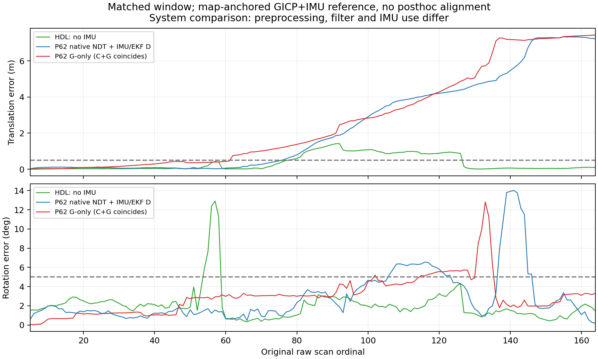

# 同raw5–164的系统级比较

所有数值重新按相同官方参考及R29插值规则计算，包含全部160个输出；未用完整2023帧RMSE冒充同窗对比。P62选取已封存的C0轨迹，未重跑。其每个导出位姿已是地图系点云刚体L，不额外重复转换IMU外参。

|系统|平移Mean/RMSE/P95/Max（m）|姿态RMSE/P95/Max（°）|参考覆盖|首个高误差raw|高误差帧|
|---|---|---|---|---:|---:|
|官方HDL，无IMU|.348687/.559410/1.090126/1.417129|2.684162/3.671148/12.912699|160/160|54|54|
|P62-R29 D：原生NDT＋IMU/EKF|2.414193/3.537730/7.290800/7.338933|4.011390/6.617301/14.006474|160/160|76|89|
|P62-R29 B：G-only|2.704655/3.794460/7.355609/7.435578|3.553957/5.640127/12.814642|160/160|62|103|
|P62-R29 C：C+G|2.704655/3.794460/7.355609/7.435578|3.553957/5.640127/12.814642|160/160|62|103|

这里的D是R29原生无前门对照，不是R21已停止的相对准入D。高误差定义为>.5m或>5°；失锁按连续3个合法高误差输出，恢复按连续3个合法低误差输出，均为参考相对描述。HDL的两段为raw54–58、78–126，低误差恢复分别从59、127开始；确认需要再等两帧。P62 B/C从62、D从76起至本窗末164未恢复。本窗以外不作推断。

## 时间与公平性边界

HDL输出在原始scan header；P62使用当帧ack时实际EKF状态时间。后者相对scan平均约9.805ms、P95约31.496ms、最大78.339ms。每条位姿均在**自己的实际时间**求同一官方参考，不把较晚状态应用到较早参考；因此是相同输入raw范围和同一时间评价规则，并非逐输出纳秒完全相等。逐项重算与R29已存同窗误差数值一致，最大差0。

HDL只用原UKF无IMU预测，P62有真实IMU/EKF/OOSM、时间缺口处理及不同门控/限步。HDL扫描0.1m体素、2647–3912点；P62为0.25m、1400点上限等既有处理。HDL NDT_OMP resolution1m/DIRECT7/原作者参数；P62原生PCL NDT resolution.8m及其冻结参数。两者复用R29同一93146点地图输入，HDL内部0.1m再次处理为89656点，P62当时目标93146点。

因此不能称“只相差C+G的严格消融”，也不能从本表唯一归因到IMU、UKF、EKF、NDT或预处理。HDL误差较小但其RMSE仍未达到本轮.5m目标，且发生持续参考高误差；不以相对旧失败系统更好宣布基线通过或SOTA优势。

## raw62、76、131：HDL的完整分层结果

数值为平移m／旋转°，所有阶段都在该扫描时间评价：

|raw|HDL匹配初值|HDL原生NDT|HDL UKF输出|fitness m²／原生inlier|解释|
|---|---|---|---|---|---|
|62|.038337／2.124440|.026656／.899323|.024422／.735385|.005152／.999330|正常产生并修正预测；没有复现P62 B/C当帧高误差。|
|76|.367134／1.764075|.433648／.912577|.426338／.845187|.006315／.998177|平移有所恶化但仍未超.5m；随后78起持续偏差，不把76直接算失锁。|
|131|.037970／2.609030|.015636／.973117|.011355／1.003884|.014171／.994859|已在127开始恢复；没有复现P62当帧大误差。|

三帧均原生收敛且产生UKF输出。没有“原生终值良好但UKF单独变坏”的当帧证据。fitness没有作者原生固定准入界限，不能事后设阈值；inlier仍带地图原点25m裁剪，不是完整Overlap。

P62同帧全部阶段与接纳/限步标记见`CRITICAL_FRAMES.csv`。例如B/C raw62原生为.425470m/4.251053°，最终实际EKF状态为.756710m/2.888346°，保留已知限步影响；raw131原生约5.532048m/13.234042°。P62 D raw131预测/原生/输出均约4.7m，而HDL同帧已低误差。不同时间的发布观测误差不能与当前EKF状态误差混写。

## H1–H3

- H1的完整前提不成立：HDL没有在全160帧保持低误差。但其在62/131较好，说明P62的部分现象并非该原始扫描必然导致的失败；不能定位到单一模块。
- H2得到有限支持：在该合同下HDL也有连续参考高误差，特别是靠近旧76的78–126段，不能把全部问题归于C+G或P62特有门控。
- H3得到支持：HDL更早出现短暂旋转误差、随后持续位置偏差但自行恢复；旧P62没有同样恢复，失效链不相同。未计算正式退化信息或重复结构归因，不能统一命名为同一个退化原因。

