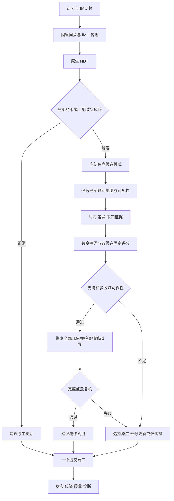

# 数据流与单次状态提交

下图是拟议系统。实现阶段将同步发布传感器原始话题和派生诊断，状态有效性由决策模块确定。

共享评分缓存按 source_id/map_id/config_hash 复用，同帧候选记录关联点号。筛选和候选库可多次读，滤波器只认一个提交令牌。影子模式同时输出候选动作和实际执行动作，确保估计状态不被尚未通过资格检查的分支改变。为验证漏检，低频探测可记录候选形状；几何处理仅在实际事件且存在合格独立候选时开启。

日志切点包括 sensor_ingest、predict、native、trigger、search、view、geometry、rank、validate、refine、fuse、publish。每点带测次、源时标、映射版本、处理时长、失败理由和否决来源。测试参考轨迹只供独立评价进程读取，先校验在线输出及配置哈希。
