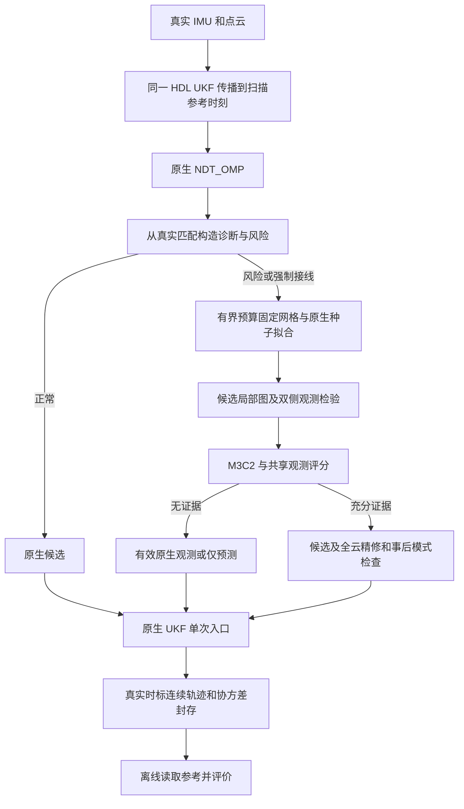

# 实际数据流

执行的候选姿态 `T_WL` 将同一雷达参考时刻的局部坐标映射至世界地图。预测视图为 `T_WL⁻¹ M_W`，无局部自由配准。固定候选从同一源点索引评分。几何差异和状态机处置分开记录。影子拦截器只记录建议，原生观测走同一实际后端。主动拦截器在地图位姿进入 UKF 前选择唯一位姿或跳过。几何误差资料尚无可信概率协方差。退化代理的旋转乘积使用 5 m 尺度，谱和本体方向保留。

真实抽取严格按既有短窗。Dog 使用 Livox 包内扫描中间时刻、归一到 m/s² 的加速度及前一历史位姿；架构已支持实际输入，没有 ROS 在线发布或一键 launch 成品。逐帧全协方差保留在运行收据引用的原始文件。
